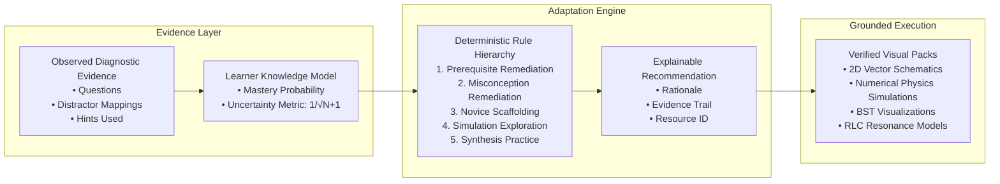

# VisiOS AI Learning Intelligence & Adaptive Engine Specification

**Module:** `src/features/adaptive/`  
**Version:** `1.0.0`  
**Architecture:** Evidence-Driven Deterministic Scaffolding Engine

---

## 1. System Architecture Overview

The VisiOS AI Learning Intelligence engine is built on a foundational principle:
> **"AI proposes learning interventions; empirical learner response evidence determines whether the intervention was effective."**

Rather than serving an open-ended conversational bot or hallucinating dynamic curricular claims, the system couples **diagnostic item analytics** with **verified visual learning resources**.

---

## 2. Learner Knowledge Model Mathematical Formulation

### 2.1 Distinction Between Evidence & Mastery
- **Non-Evidence Activities**: Navigating pages, opening visualizations, dwell time, or watching animations **never** increment estimated mastery.
- **Evidence Activities**: Atomic diagnostic question answers, verified problem solutions, and hints consumed.

### 2.2 Uncertainty Score Calculation
As the count of empirical observations $N$ increases for a concept, uncertainty $\sigma$ decays monotonically:
$$\sigma(N) = \min\left(1.0, \max\left(0.05, \frac{1}{\sqrt{N + 1}}\right)\right)$$

### 2.3 Evidence-Weighted Mastery Probability
Let $w_i$ be the difficulty weight for attempt $i$ ($1.0$ for beginner, $1.2$ for intermediate, $1.5$ for advanced), penalized by hint usage $h_i$:
$$w_{\text{eff}, i} = w_i \times \max(0.40, 1.0 - 0.25 h_i)$$
$$\text{Raw Accuracy} = \frac{\sum_{i \in \text{correct}} w_{\text{eff}, i}}{\sum_{i} w_i}$$
$$\hat{P}(\text{Mastery}) = \text{Raw Accuracy} \times (1 - \sigma(N)) + 0.50 \times \sigma(N)$$

### 2.4 Mastery Status Classification
- **Unassessed**: $N = 0, \sigma = 1.0$
- **Novice**: $\hat{P} < 0.40 \text{ or } (N < 2 \text{ and Raw Accuracy} < 0.80)$
- **Developing**: $0.40 \le \hat{P} < 0.65$
- **Proficient**: $0.65 \le \hat{P} < 0.80$
- **Mastered**: $\hat{P} \ge 0.80 \text{ and } \sigma < 0.50$

---

## 3. Explainable Adaptation Rules Hierarchy

When an intervention recommendation is requested, the engine evaluates rules in strict priority order:

1. **`RULE-PREREQ-REMEDIATION` (Priority 1)**:
   - *Condition*: Prerequisite concept confidence $< 0.45$.
   - *Action*: Recommends `prerequisite_review` with foundation summary.
2. **`RULE-MISCONCEPTION-TARGETED` (Priority 2)**:
   - *Condition*: Diagnostic option selected maps to an active misconception in `VALIDATED_MISCONCEPTIONS`.
   - *Action*: Recommends validated remedial visual intervention with authoritative literature citation.
3. **`RULE-NOVICE-VISUAL-SCAFFOLDING` (Priority 3)**:
   - *Condition*: Mastery status is `unassessed` or `novice`.
   - *Action*: Recommends `labeled_2d_diagram` or `simpler_text` to establish mental model.
4. **`RULE-DEVELOPING-SIMULATION-EXPLORATION` (Priority 4)**:
   - *Condition*: Mastery status is `developing`.
   - *Action*: Recommends `guided_simulation` with active parameter manipulation.
5. **`RULE-PROFICIENT-PRACTICE` (Priority 5)**:
   - *Condition*: Mastery status is `proficient` or `mastered`.
   - *Action*: Recommends `targeted_practice` or synthesis challenge.

---

## 4. Scientific Correctness Guarantees
- **Deterministic Numerical Calculations**: All physics and electronics parameters (e.g. $T \approx T_0(1 + \theta_0^2/16)$, $\omega_0 = 1/\sqrt{LC}$, $Q = (1/R)\sqrt{L/C}$) are computed via compiled TypeScript mathematical algorithms, never synthesized or hallucinated by language models.
- **Zero Arbitrary Code Execution**: No untrusted client-side script execution or dynamic HTML injection.

