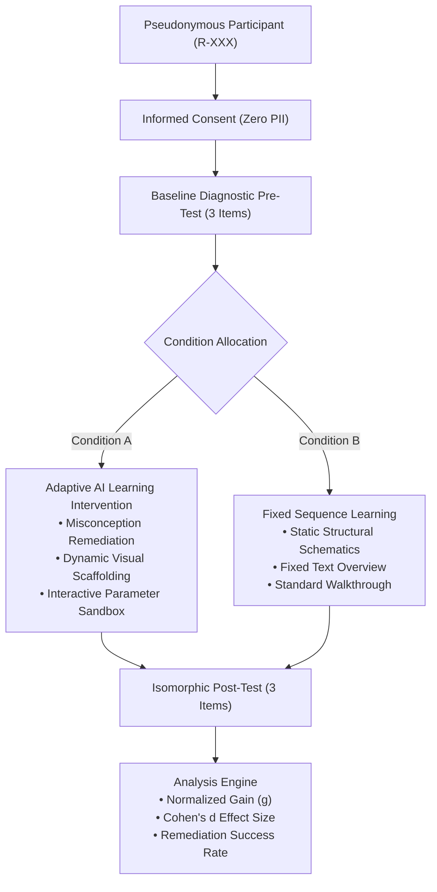

# VisiOS Research Protocol: Evidence-Driven Adaptive Visual Learning vs. Fixed Curricula

**Document Version:** `1.0.0`  
**Status:** Validated Research Specification  
**Ethical Review:** Zero-PII Pseudonymous Protocol (Right-to-Erasure Compliant)

---

## 1. Executive Summary & Research Questions

The core objective of VisiOS Milestone 19 is to determine whether **evidence-driven AI adaptive learning** improves immediate conceptual understanding, remediates systematic domain misconceptions, and optimizes learner efficiency compared to a standard **fixed linear curriculum**.

### Primary Research Question
> *"Does evidence-driven, diagnostic selection of interactive visual interventions (phase portraits, parameter sweeps, tree rebalancing) produce statistically significant conceptual gains compared with a fixed linear sequence of visual materials?"*

### Primary Hypothesis ($H_1$)
Learners assigned to **Condition A (Adaptive Intervention)** will demonstrate significantly higher normalized learning gain ($g_{\text{adaptive}} > g_{\text{control}}$ with effect size Cohen's $d \ge 0.50$) on isomorphic post-test assessments compared to learners in **Condition B (Fixed Sequence Control)**.

---

## 2. Experimental Design & Methodology

### 2.1 Study Conditions
The experiment employs a randomized, counterbalanced between-subjects A/B design:

1. **Condition A — Adaptive Visual Intervention (Treatment)**:
   - Real-time diagnostic evaluation of pre-test selections.
   - Dynamic detection of distractor-mapped misconceptions (e.g. `misconception-mass-period`).
   - Adaptive recommendation engine delivers targeted visual scaffolding (phase space trajectories, nonlinear parameter sweeps, structured trees).
   - Full pedagogical rationale and evidence trail rendered transparently to the learner.
2. **Condition B — Fixed Sequence Curriculum (Active Control)**:
   - Standard linear sequence of curricular explanations and static diagrams without dynamic branching or diagnostic personalization.
   - Equal time-on-task allowance and identical post-test verification items.

---

## 3. Diagnostic Question Bank & Misconception Taxonomy

Each diagnostic item includes validated distractor options mapped directly to specific conceptual failure modes:

| Subject | Target Concept | Validated Misconception | Diagnostic Symptom | Remedial Intervention |
|---|---|---|---|---|
| **Physics** | Nonlinear Pendulum | `misconception-mass-period` | Assumes period $T \propto \sqrt{m}$ | Interactive simulation verifying mass independence ($F=mg \implies a=g\sin\theta$) |
| **Physics** | Large Angle Dynamics | `misconception-amplitude-invariance` | Extrapolates $T=2\pi\sqrt{L/g}$ to $\theta_0=85^\circ$ | 3D visual demonstrating $\sin\theta < \theta$ restoring torque deficit |
| **Physics** | Damped Oscillations | `misconception-damping-frequency` | Treats damping as simple scaling | 2D phase portrait $(\theta, \omega)$ showing spiral convergence to origin |
| **Computer Science** | BST Invariants | `misconception-bst-heap` | Confuses BST $L < P < R$ with Heap $P > L, R$ | Worked example contrasting binary search tree with max-heap |
| **Computer Science** | Tree Degeneracy | `misconception-unbalanced-lookup` | Assumes BST lookup is always $O(\log n)$ | 2D tree schematic showing degenerate $O(n)$ linked list chain |
| **Electronics** | RLC Resonance | `misconception-resonance-resistance` | Believes series $R$ alters resonant frequency $\omega_0$ | Frequency response simulation showing $\omega_0 = 1/\sqrt{LC}$ invariant |
| **Electronics** | Quality Factor | `misconception-q-factor-bandwidth` | Believes high $Q$ widens bandwidth | Worked calculation of $Q = \omega_0 / \Delta\omega$ selectivity |

---

## 4. Statistical Evaluation Metrics

### 4.1 Absolute Score Gain ($\Delta$)
$$\Delta = \text{Score}_{\text{post}} - \text{Score}_{\text{pre}}$$

### 4.2 Normalized Learning Gain ($g$)
To avoid ceiling effects and normalize across initial baseline variation:
$$g = \frac{\text{Score}_{\text{post}} - \text{Score}_{\text{pre}}}{100 - \text{Score}_{\text{pre}}} \quad (\text{for } \text{Score}_{\text{pre}} < 100)$$

### 4.3 Standardized Effect Size (Cohen's $d$)
$$d = \frac{\bar{X}_{\text{adaptive}} - \bar{X}_{\text{control}}}{s_{\text{pooled}}}$$
$$s_{\text{pooled}} = \sqrt{\frac{(n_A - 1)s_A^2 + (n_C - 1)s_C^2}{n_A + n_C - 2}}$$

### 4.4 Misconception Remediation Rate ($R_{\text{misconception}}$)
$$R_m = \frac{\text{Participants who answered isomorphic post-test correctly}}{\text{Participants who exhibited misconception } m \text{ during pre-test}} \times 100\%$$

---

## 5. Privacy, Ethics & Right-to-Erasure

1. **Zero Personally Identifiable Information (PII)**:
   - No names, emails, student IDs, or IP addresses are collected.
   - Participants generate pseudonymous identifiers (e.g., `R-101`).
2. **Informed Consent**:
   - Explicit modal consent explaining voluntary participation, study goals, and time commitment.
3. **GDPR Right-to-Erasure**:
   - Participants or investigators can immediately erase all session records, diagnostic logs, and timestamps by submitting their participant code in the dashboard or via `POST /api/research { action: 'delete_participant' }`.

---

## 6. Threats to Validity & Limitations

1. **Sample Size & Statistical Power**: Formative pilot evaluations with $N < 30$ per condition must be reported as preliminary trends rather than definitive causal proofs.
2. **Single-Session Immediate Testing**: Post-tests evaluate immediate recall and short-term reasoning. Longitudinal delayed retention tests ($t = 14\text{ days}$) are required for permanent mastery claims.
3. **Self-Selection Bias**: Voluntary digital testers may possess higher baseline motivation than general student populations.

